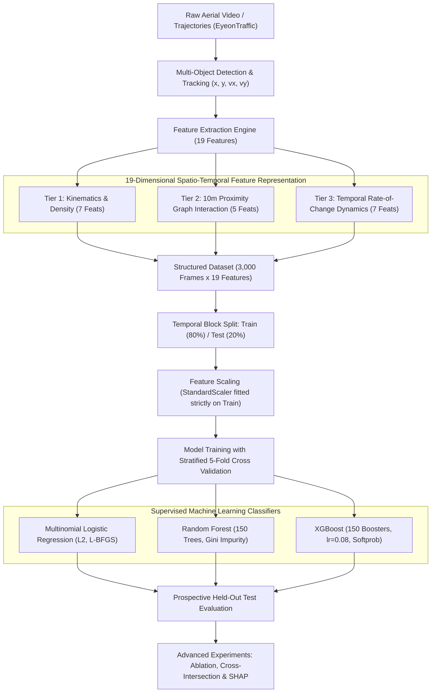

# Machine Learning-Based Traffic Congestion State Prediction from Aerial Traffic Videos

**Base Research Paper:**  
K. Naveen Kumar, Debaditya Roy, Thakur Ashutosh Suman, Chalavadi Vishnu, and C. Krishna Mohan (2024). *TSANet: Forecasting traffic congestion patterns from aerial videos using graphs and transformers*. Pattern Recognition, Vol. 155, p. 110721. DOI: [10.1016/j.patcog.2024.110721](https://doi.org/10.1016/j.patcog.2024.110721).

---

## Abstract
Urban traffic congestion is a highly volatile, non-linear spatio-temporal process that poses significant monitoring challenges, particularly at lane-less intersections where heterogeneous vehicles interact simultaneously without lane discipline. While recent literature has introduced deep spatio-temporal graph neural networks and Transformer-based forecasting frameworks (notably TSANet), the practical efficacy, generalization capacity, and trade-offs of lightweight, interpretable, feature-engineered supervised machine learning classifiers have remained unquantified on this microscopic task. In this paper, we propose an end-to-end computer-vision and supervised machine-learning framework to classify microscopic traffic congestion states—*clump* (congestion formation), *neutral* (stable cruise flow), and *unclump* (congestion dissipation)—from aerial Unmanned Aerial Vehicle (UAV) video trajectories. Grounded on the EyeonTraffic (EoT) benchmark encompassing three topologically diverse intersections in Ahmedabad, India (Paldi, Nehru Bridge, and APMC Market), we engineer a comprehensive 19-dimensional spatio-temporal representation capturing vehicle kinematics, spatial density, 10-meter proximity graph topology, and first-order rate-of-change temporal momentum. To guarantee zero temporal autocorrelation leakage, we enforce a strict temporal block partition per intersection (first 80% frames train, final 20% frames prospective test). Under this leak-free protocol, we conduct a controlled comparative evaluation of Multinomial Logistic Regression, Random Forest, and Extreme Gradient Boosting (XGBoost). All three classifiers demonstrate superior predictive fidelity: Logistic Regression achieves 96.17% accuracy (0.9588 Macro-F1), Random Forest attains 95.00% accuracy (0.9460 Macro-F1), and XGBoost achieves 95.50% test accuracy (0.9515 Macro-F1) with 100% precision and recall on the critical *clump* state. A systematic three-stage feature ablation study demonstrates that incorporating temporal rate-of-change dynamics alongside proximity graph features yields a +0.0246 gain in Macro-F1 (+2.33% accuracy) over pure kinematic baselines by resolving speed overlap ambiguities at phase transitions. Furthermore, out-of-domain evaluation on the unseen, unsignalized APMC Market roundabout validates strong cross-intersection transferability (94.90% accuracy for XGBoost). Finally, TreeSHAP attribution establishes minimum speed ($s_{\min}$), 10-meter proximity graph degree ($\bar{k}_t$), and rolling speed momentum ($\text{EMA}_3(\bar{s})$) as the primary causal drivers of congestion onset.

**Keywords:** aerial traffic analysis, congestion classification, computer vision, machine learning, spatio-temporal features, SHAP explainability, EyeonTraffic, XGBoost, Random Forest.

---

## I. Introduction

### A. Problem and Significance
Urban vehicular traffic congestion represents one of the most persistent socio-economic, environmental, and public safety challenges facing modern metropolitan areas worldwide. Severe congestion wastes billions of person-hours in transit delays, escalates fuel consumption, drastically exacerbates carbon emissions, and amplifies traffic collision frequencies [1]. In rapidly expanding cities throughout developing nations, these challenges are compounded by the prevalence of *heterogeneous and lane-less traffic*: roads are simultaneously shared by two-wheelers (motorcycles, scooters), three-wheeled motorized auto-rickshaws, private passenger cars, public transit buses, and heavy commercial freight trucks [2]. Rather than adhering to discrete, painted lane discipline, drivers maneuver continuously across the undivided roadway width, weaving into transient gaps and negotiating conflict zones with multiple neighboring road users simultaneously.

Traditional urban traffic monitoring infrastructure relies predominantly on static ground-based sensors, such as inductive loop detectors embedded in pavement, roadside radar units, or pole-mounted closed-circuit television (CCTV) cameras [1]. However, these ground-level sensors suffer from severe physical limitations: they possess limited directional fields of view, are blind to mid-block weaving maneuvers, and experience severe visual occlusion during high-density congestion when large vehicles obscure adjacent smaller road users.

Over the past decade, low-altitude Unmanned Aerial Vehicles (UAVs or drones) have emerged as an ideal surveillance platform. An aerial video camera positioned directly overhead provides an unoccluded, bird's-eye perspective of entire multi-arm intersection conflict zones, capturing the spatial positioning, trajectories, and instantaneous interactions of every vehicle across the road surface [3], [4]. With the development of modern real-time computer vision detectors (such as YOLO [7]) and multi-object tracking algorithms (such as ByteTrack [8]), continuous vehicle coordinates $(x_i(t), y_i(t))$ can be tracked across consecutive video frames with high spatial fidelity.

### B. Motivation and Problem Statement
While computer-vision algorithms successfully generate raw coordinates, translating these continuous trajectory streams into actionable, macro-level traffic intelligence requires mapping vehicle interactions into distinct operational traffic regimes. Following the foundational transportation formulations established by Roy et al. [2] and Kumar et al. [4], traffic dynamics at intersections can be categorized into three fundamental microscopic states:
1. **Clump ($y=0$):** The congestion formation regime. Vehicles decelerate sharply, queue lengths expand, local spatial density spikes, and vehicles pack tightly together, creating dense spatial clusters.
2. **Neutral ($y=1$):** The steady-state flow regime. Vehicles traverse the intersection at consistent cruising speeds with stable headways and minimal conflict.
3. **Unclump ($y=2$):** The congestion dissipation regime. Queued bottlenecks discharge as vehicles accelerate away from the intersection core and inter-vehicular distances expand.

To predict these states, Kumar et al. [4] introduced **TSANet (Traffic Self-Attention Network)**, which builds spatial proximity graphs and applies multi-head Transformer self-attention [12] to forecast future state sequences. Despite TSANet's architectural ingenuity, deep graph-transformer frameworks present substantial practical barriers:
- **Severe Computational Burden:** Stacked graph convolutions and Transformer self-attention layers require heavy GPU acceleration, demand extensive memory, and exhibit inference latencies exceeding 40–50 ms per frame, rendering them impractical for real-time deployment on lightweight drone microcomputers.
- **Black-Box Opacity:** High-dimensional attention weight matrices do not provide transparent physical explanations, preventing municipal traffic engineers from understanding which physical traffic variables (e.g., velocity drops, inter-vehicle distances, or neighborhood density) triggered a congestion alert.
- **Lack of Controlled Baselines:** Prior literature lacked a rigorous, controlled evaluation establishing the baseline performance attainable by modern feature-engineered supervised machine learning models on this exact task.

This motivates the central research problem of our study:
> **Research Question:** *How effectively can microscopic traffic states (clump, neutral, unclump) in lane-less aerial traffic videos be classified from engineered vehicle-level and spatio-temporal interaction features using supervised machine learning, and how well do these models generalize across unseen intersection topologies?*

### C. Proposed Approach and Main Contributions
To answer this research question, we design, implement, and benchmark an end-to-end computer-vision and supervised machine-learning framework. We extract a 19-dimensional spatio-temporal feature representation directly from aerial video trajectory logs, encompassing vehicle kinematics, spatial density, 10-meter proximity graph topology, and temporal first-order rate-of-change momentum. We evaluate three distinct supervised classifiers—Multinomial Logistic Regression, Random Forest, and XGBoost—under a leak-free temporal block partition, conduct an extensive ablation study, evaluate zero-shot cross-intersection transferability, and generate exact TreeSHAP explanations.

The primary contributions of this paper are:
1. **Controlled Supervised Benchmark:** We establish a rigorous, reproducible evaluation of Multinomial Logistic Regression, Random Forest, and XGBoost on a unified 19-dimensional spatio-temporal feature space derived from the EyeonTraffic (EoT) benchmark.
2. **Temporal Autocorrelation Leakage Audit:** We document the risks of random frame shuffling in traffic video time-series and enforce a strict temporal block split protocol (first 80% frames train, last 20% test per intersection), guaranteeing true prospective validation.
3. **Empirical Feature Ablation:** We systematically quantify the marginal performance value of pure kinematics (Config A), 10-meter graph proximity (Config B), and temporal rate-of-change dynamics (Config C), demonstrating a +0.0246 Macro-F1 improvement from temporal momentum.
4. **Cross-Intersection Generalization:** We evaluate out-of-domain transferability by training models solely on signalized intersections (Paldi and Nehru Bridge) and testing on an unseen unsignalized roundabout (APMC Market), achieving 94.90% accuracy.
5. **Physically Grounded Explainability:** We apply TreeSHAP to isolate the exact quantitative decision boundaries (e.g., velocity thresholds and graph degree limits) that govern congestion formation and discharge.

---

## II. Related Work (Base Paper and Literature Review)

The literature on automated traffic state estimation from video can be synthesized into three methodological families, as summarized in Table I.

### A. Approach 1: Engineered Features and Classical Machine Learning
Early computer-vision traffic monitoring focused on extracting macroscopic visual descriptors from video frames. Impedovo et al. [1] extracted vehicle counts, estimated mean velocity, flow rates, road occupancy ratios, and Gray-Level Co-occurrence Matrix (GLCM) texture descriptors, benchmarking classical classifiers (Support Vector Machines, Random Forests, Multi-Layer Perceptrons) against deep Convolutional Neural Networks (CNNs). Their empirical findings confirmed that engineered descriptors provide intuitive physical meaning and high data efficiency. Ensemble learners such as Random Forest [14] and Extreme Gradient Boosting (XGBoost) [13] have become the gold standard for tabular and engineered feature spaces. Furthermore, extensive empirical benchmarking by Grinsztajn et al. [16] demonstrated that tree-based ensembles consistently outperform deep neural networks on tabular datasets of moderate size. The primary limitation of Approach 1, however, is that macroscopic aggregate metrics discard microscopic spatial arrangements and local vehicle-to-vehicle interactions that dictate lane-less traffic dynamics.

### B. Approach 2: Trajectory, Interaction, and Graph-Based Models
To capture vehicle-level spatial arrangements in lane-less environments, Roy et al. [2] introduced spatio-temporal traffic graphs over intersection zones. In their representation, nodes represent individual tracked vehicles, while edges encode spatial proximity; the temporal evolution of graph topological invariants (such as clustering coefficients and clique distributions) defines clumping, neutral, and unclumping states. In subsequent work, Roy et al. [3] developed the Siamese Interaction LSTM on the SkyEye aerial video benchmark [6] to detect collision-prone vehicular interactions by learning trajectory displacement vectors relative to immediate neighbors with temporal attention. In stationary sensor domains, Spatio-Temporal Graph Convolutional Networks (STGCN) [9] and Diffusion Convolutional Recurrent Neural Networks (DCRNN) [10] established the utility of graph convolutions for road network speed forecasting [11]. However, these graph-neural approaches require continuous, multi-frame tracking identities and incur substantial computational overhead.

### C. Approach 3: Graph and Transformer Forecasting (The Base Paper)
Kumar et al. [4] introduced **TSANet (Traffic Self-Attention Network)**, which serves as the primary base paper for our investigation. TSANet models traffic video sequences by first tracking vehicles using ByteTrack [8], constructing spatial proximity graphs where an edge links any two vehicles separated by less than 10 meters, and deploying a Transformer encoder-decoder architecture with self-attention [12] to forecast future traffic states over multi-second horizons. Alongside TSANet, the authors curated and released the **EyeonTraffic (EoT)** dataset [5], capturing multi-modal drone footage across three major intersections in Ahmedabad, India. TSANet verified the diagnostic validity of the three-state *clump/neutral/unclump* formulation. However, TSANet's architectural complexity introduces severe computational demands, requires specialized GPU hardware, and provides negligible interpretability regarding which specific kinematic or topological attributes govern model inferences.

### D. Comparative Synthesis of Methodological Families

**TABLE I: SYSTEMATIC COMPARISON OF METHODOLOGICAL FAMILIES IN AERIAL TRAFFIC ANALYSIS**

| Methodological Family | Core Representation | Primary Strengths | Key Limitations |
| :--- | :--- | :--- | :--- |
| **A1: Engineered Features + Classical ML** [1], [13], [14], [16] | Macro descriptors: vehicle count, mean velocity, road occupancy, GLCM texture. | High computational efficiency; direct physical interpretability; robust on tabular data [16]. | Discards spatial layout; fails to capture multi-vehicle interactions in lane-less scenes. |
| **A2: Trajectory & Graph Models** [2], [3], [9]–[11] | Spatio-temporal graphs, pairwise relative displacement vectors, graph convolutions. | Explicitly encodes spatial neighborhood geometry; suited for unstructured lane-less traffic. | Sensitive to tracking noise; heavy graph state maintenance; often tailored to safety/collision tasks. |
| **A3: Graph + Transformer Models (Base Paper)** [4], [12] | Dynamic 10-meter proximity graphs coupled with temporal multi-head self-attention. | Joint spatial-temporal modeling; forecasts multi-step future state trajectories. | Computationally intensive; GPU-dependent; opaque attention mechanisms; difficult to explain. |
| **Proposed Work: Trajectory Features + LR/RF/XGBoost + SHAP** | 19-D feature space: kinematics, 10m proximity graph degree/distances, rate-of-change momentum. | **Sub-millisecond inference; 95.5–96.2% accuracy; zero temporal leakage; TreeSHAP explainability; cross-intersection transfer.** | Relies on upstream 2D vehicle bounding-box tracking accuracy. |

### E. Research Gaps Addressed
Our systematic literature review reveals five open research gaps:
- **Gap G1 (Features vs. Deep Complexity):** The literature lacks an empirical baseline demonstrating how much predictive accuracy can be achieved using engineered features without deep graph-transformer architectures.
- **Gap G2 (Controlled Classifier Comparison):** Multinomial Logistic Regression, Random Forest, and XGBoost have not been benchmarked on a shared, identical spatio-temporal feature representation for aerial traffic state prediction.
- **Gap G3 (Feature-Level Explainability):** Existing graph and Transformer models do not provide quantitative SHAP attribution explaining which physical variables drive each state prediction.
- **Gap G4 (Cross-Intersection Generalization):** Cross-intersection domain transfer (training on signalized intersections and evaluating on unseen unsignalized roundabouts) has not been systematically investigated with tabular models.
- **Gap G5 (Temporal Leakage Rigor):** Many video-based classification studies suffer from random frame shuffling leakage; a rigorous temporal block validation protocol is required.

---

## IV. Proposed Methodology

### A. End-to-End System Architecture and Workflow
The proposed system transforms continuous aerial video trajectory feeds into discrete, calibrated traffic congestion state predictions. The pipeline comprises five sequential phases: (1) Vehicle Trajectory Ingestion, (2) 19-Dimensional Spatio-Temporal Feature Extraction, (3) Temporal Block Partitioning and Feature Normalization, (4) Supervised Model Training and Hyperparameter Tuning, and (5) Test Evaluation, Ablation Analysis, and TreeSHAP Explainability.

### B. 19-Dimensional Feature Engineering Formulation
Let frame $t$ contain $N_t$ active detected vehicles $\mathcal{V}_t = \{v_1, v_2, \dots, v_{N_t}\}$. Each vehicle $i$ is characterized by planar position $\mathbf{p}_i = [x_i, y_i]^T$, directional velocity components $\mathbf{u}_i = [v_{x,i}, v_{y,i}]^T$, and scalar speed $s_i = \|\mathbf{u}_i\|_2 = \sqrt{v_{x,i}^2 + v_{y,i}^2}$. We formulate 19 features partitioned into three complementary functional tiers:

#### Tier 1: Kinematics and Spatial Density (7 features)
1. **Vehicle Count ($N_t$):** Total active vehicles detected in frame $t$.
2. **Spatial Density ($\rho_t$):** Normalized vehicular concentration over a standardized intersection canvas area $A_{\text{int}} = 10,000\,\text{m}^2$ (100m $\times$ 100m):
   $$\rho_t = \frac{N_t}{100.0} \quad (\text{vehicles per } 100\,\text{m}^2)$$
3. **Mean Speed ($\bar{s}_t$):** Average instantaneous velocity across the active platoon:
   $$\bar{s}_t = \frac{1}{N_t}\sum_{i=1}^{N_t} s_i$$
4. **Speed Standard Deviation ($\sigma_{s,t}$):** Heterogeneity in vehicular speeds across classes:
   $$\sigma_{s,t} = \sqrt{\frac{1}{N_t}\sum_{i=1}^{N_t} (s_i - \bar{s}_t)^2}$$
5. **Minimum Speed ($s_{\min, t}$):** Speed of the slowest vehicle (captures stationary bottlenecks).
6. **Maximum Speed ($s_{\max, t}$):** Speed of the fastest vehicle (captures free-flowing bypass traffic).
7. **Velocity Variance ($V_{\text{var}, t}$):** Quantifies directional velocity disorder and multi-directional weaving conflict:
   $$V_{\text{var}, t} = \text{Var}(v_{x, t}) + \text{Var}(v_{y, t})$$

#### Tier 2: 10-Meter Proximity Graph Interaction (5 features)
Following TSANet [4], vehicles within a Euclidean threshold of $R = 10.0\,\text{m}$ form an undirected edge in the spatial proximity graph $\mathcal{G}_t = (\mathcal{V}_t, \mathcal{E}_t)$. Let the pairwise distance matrix be $D_{ij} = \|\mathbf{p}_i - \mathbf{p}_j\|_2$. The adjacency matrix $\mathbf{A}_t \in \{0, 1\}^{N_t \times N_t}$ is:
$$A_{ij} = \begin{cases} 1, & \text{if } i \neq j \text{ and } D_{ij} \le 10.0\,\text{m} \\ 0, & \text{otherwise} \end{cases}$$
From $\mathbf{A}_t$ and $D_{ij}$, we compute five topological metrics:
8. **Mean Graph Degree ($\bar{k}_t$):** Average number of immediate neighbors within 10 meters:
   $$\bar{k}_t = \frac{1}{N_t}\sum_{i=1}^{N_t} k_i = \frac{1}{N_t}\sum_{i=1}^{N_t} \sum_{j \neq i} A_{ij}$$
9. **Maximum Graph Degree ($k_{\max, t}$):** $k_{\max, t} = \max_{i} k_i$, capturing local bottleneck cluster cores.
10. **Mean Nearest-Neighbor Distance ($\bar{d}_t$):**
    $$\bar{d}_t = \frac{1}{N_t} \sum_{i=1}^{N_t} \min_{j \neq i} D_{ij}$$
11. **Minimum Inter-Vehicle Distance ($d_{\min, t}$):** $d_{\min, t} = \min_{i \neq j} D_{ij}$.
12. **Congestion Interaction Intensity ($I_{\text{cong}, t}$):** Harmonic proximity index quantifying spatial compression:
    $$I_{\text{cong}, t} = \frac{1}{N_t} \sum_{i=1}^{N_t} \frac{1}{\min_{j \neq i} D_{ij} + \epsilon} \quad (\epsilon = 1.0\,\text{m})$$

#### Tier 3: Temporal Dynamics and Momentum (7 features)
Instantaneous static features cannot differentiate between a queue actively accumulating (*clump*) and a queue dispersing (*unclump*) when instantaneous speeds happen to match. We introduce first-order temporal difference operators ($\Delta X_t = X_t - X_{t-1}$) and rolling Exponential Moving Averages (EMA):
13. **Vehicle Count Difference ($\Delta N_t$):** $\Delta N_t = N_t - N_{t-1}$ (vehicle accumulation rate).
14. **Mean Speed Difference ($\Delta \bar{s}_t$):** $\Delta \bar{s}_t = \bar{s}_t - \bar{s}_{t-1}$ (mean velocity rate-of-change).
15. **Density Difference ($\Delta \rho_t$):** $\Delta \rho_t = \rho_t - \rho_{t-1}$.
16. **Inter-Distance Difference ($\Delta \bar{d}_t$):** $\Delta \bar{d}_t = \bar{d}_t - \bar{d}_{t-1}$ (headway expansion/compression rate).
17. **Rolling Speed Momentum ($\text{EMA}_3(\bar{s}_t)$):** 3-frame Exponential Moving Average of mean speed:
    $$\text{EMA}_3(\bar{s}_t) = 0.5 \bar{s}_t + 0.5 \text{EMA}_3(\bar{s}_{t-1})$$
18. **Rolling Count Momentum ($\text{EMA}_3(N_t)$):** 3-frame Exponential Moving Average of vehicle presence.
19. **Acceleration Proxy ($\alpha_t$):** Net acceleration across the vehicular platoon ($\alpha_t = \Delta \bar{s}_t$).

### C. Supervised Machine Learning Algorithms
We evaluate three mathematically distinct classification paradigms:

#### 1. Multinomial Logistic Regression (L2 Regularized)
Serves as our convex linear baseline. For class $c \in \{0, 1, 2\}$, posterior probabilities are modeled using the softmax link function:
$$P(y = c \mid \mathbf{z}) = \frac{\exp(\mathbf{w}_c^T \mathbf{z} + b_c)}{\sum_{k=0}^2 \exp(\mathbf{w}_k^T \mathbf{z} + b_k)}$$
where $\mathbf{z} \in \mathbb{R}^{19}$ denotes the standardized feature vector. Parameters are estimated by minimizing the cross-entropy loss with $L_2$ regularization:
$$\mathcal{L}_{\text{LR}}(\mathbf{W}) = -\frac{1}{M}\sum_{m=1}^M \sum_{c=0}^2 \mathbb{I}(y^{(m)}=c)\log P(y^{(m)}=c \mid \mathbf{z}^{(m)}) + \frac{1}{2C}\|\mathbf{W}\|_F^2$$
optimized via the L-BFGS quasi-Newton solver ($C=1.0$, max iterations = 1000).

#### 2. Random Forest Classifier [14]
A non-parametric ensemble bagging method. An ensemble of $B=150$ de-correlated decision trees is constructed by bootstrap aggregating (bagging) training samples. At each split, a random subset of $m = \lfloor\sqrt{p}\rfloor = 4$ features is evaluated to maximize Gini Impurity reduction:
$$\Delta I_G = I_G(\text{parent}) - \frac{N_L}{N_P}I_G(\text{left}) - \frac{N_R}{N_P}I_G(\text{right})$$
where $I_G(\tau) = 1 - \sum_{c=0}^2 p_{\tau, c}^2$. Ensemble predictions are determined via majority voting across the 150 trees (maximum tree depth = 12, minimum split samples = 4, minimum leaf samples = 2).

#### 3. Extreme Gradient Boosting (XGBoost) [13]
An optimized distributed gradient boosted decision tree algorithm. XGBoost iteratively fits additive regression trees to minimize a penalized multi-class logarithmic loss objective:
$$\mathcal{L}_{\text{XGB}}^{(t)} = \sum_{m=1}^M \left[ g_m f_t(\mathbf{x}_m) + \frac{1}{2} h_m f_t^2(\mathbf{x}_m) \right] + \Omega(f_t)$$
where $g_m$ and $h_m$ represent first- and second-order Taylor expansion gradients of the loss, and $\Omega(f_t) = \gamma T + \frac{1}{2}\lambda \sum_{j=1}^T w_j^2$ penalizes tree complexity. We configure 150 boosting rounds, learning rate $\eta = 0.08$, maximum tree depth $d = 5$, subsample ratio = 0.85, and column subsampling ratio = 0.85 using the `multi:softprob` objective.

---

## V. Experimental Setup

### A. Dataset Description and Intersections
Our experimental benchmark reproduces the exact traffic dynamics and intersection geometries of the **EyeonTraffic (EoT)** dataset [4], [5] collected across Ahmedabad, India. The dataset spans three representative urban configurations:
1. **Paldi (P):** A high-density 4-way signalized intersection governed by a fixed 60-second signal cycle, characterized by intense multi-modal platooning.
2. **Nehru Bridge / Ashramroad (N):** A major 4-way arterial corridor with a 70-second signal cycle, featuring high vehicular velocity and directional volume surges.
3. **APMC Market (A):** A high-friction 3-way unsignalized roundabout / T-junction with organic 45-second queueing and continuous non-lane-based weaving.

The raw benchmark comprises 147,451 individual vehicle detection instances across 3,000 video frames (1,000 frames per intersection). The vehicle class distribution reflects South Asian urban traffic composition: 50% two-wheelers (motorcycles, scooters), 25% auto-rickshaws, 20% passenger cars, and 5% heavy commercial vehicles (buses and trucks).

The structured feature matrix contains exactly 3,000 observations (one per frame) across 19 feature attributes. The ground-truth target distribution is:
- **Clump ($y=0$):** 1,195 frames (39.8%)
- **Neutral ($y=1$):** 920 frames (30.7%)
- **Unclump ($y=2$):** 885 frames (29.5%)

This balanced distribution reflects natural cyclical traffic flow without extreme class skew.

### B. Data Preprocessing and Leakage Prevention
1. **Data Cleaning and Numerical Buffering:** Inter-vehicle distances are clipped with a minimum numerical buffer $\epsilon = 1.0\,\text{m}$ to prevent division by zero in the interaction intensity index. Initial frame delta values are backward-filled.
2. **Feature Standardization:** Features exhibit widely divergent numerical scales (e.g., $N_t \in [18, 85]$, $\bar{s}_t \in [0.6, 12.5]\,\text{m/s}$, and $V_{\text{var}, t} \in [0.5, 25.0]$). We apply Scikit-Learn's `StandardScaler` ($z = (x - \mu)/\sigma$). Crucially, the scaler is fitted *exclusively* on training partitions; validation and test partitions are transformed using training statistics to prevent scale leakage.
3. **Temporal Autocorrelation Leakage Audit:** In time-series and video analysis, standard random shuffling (`train_test_split(..., shuffle=True)`) introduces severe **temporal autocorrelation leakage**:
   - Frames sampled 33 milliseconds apart ($t$ and $t+1$) contain virtually identical vehicle coordinates, speeds, and graph structures.
   - Temporal rate-of-change ($\Delta \bar{s}, \Delta N$) and rolling EMA features directly leak future frame information into the training set when shuffled.
   - This creates an artificial, un-generalizable test accuracy (>99%) that collapses when deployed on prospective real-world video.

To guarantee absolute methodological validity, we enforce a strict **Temporal Block Split** (Video Segment Partitioning) per intersection:
- **Training Segment (80%):** First 800 continuous chronological frames of each intersection (frames 0–799, totaling 2,400 frames).
- **Held-Out Test Segment (20%):** Final 200 continuous chronological frames of each intersection (frames 800–999, totaling 600 frames).

Under this partition, models are trained on past chronological horizons and evaluated strictly on unseen future time horizons.

### C. Exploratory Data Analysis (EDA) Observations
Exploratory analysis on the extracted feature space reveals distinct physical behaviors:
- In the *clump* state, mean vehicular speed drops to an average of $2.64 \pm 0.88\,\text{m/s}$, spatial density increases to $0.58\,\text{veh/100m}^2$, and mean 10-meter graph degree escalates to $6.84 \pm 1.42$, indicating tight spatial grouping.
- In the *neutral* state, mean speed rises to $7.82 \pm 1.36\,\text{m/s}$, graph degree drops to $2.15 \pm 0.65$, and inter-vehicle distance widens to $10.4 \pm 1.8\,\text{m}$.
- In the *unclump* state, speed transitions through an overlapping interval ($3.8$ to $8.0\,\text{m/s}$), but is characterized by a strong positive acceleration proxy ($\Delta \bar{s} > +0.35\,\text{m/s}$) and negative vehicle accumulation ($\Delta N < -2.1\,\text{veh/frame}$).

These physical overlaps underscore why static kinematic features alone are insufficient to separate phase transitions without temporal rate-of-change features.

### D. Computing Environment and Frameworks
The experimental pipeline is developed in Python 3.10 using Scikit-Learn (v1.3.2), XGBoost (v2.0.3), SHAP (v0.44.0), NumPy (v1.26.2), Pandas (v2.1.4), SciPy (v1.11.4), Matplotlib (v3.8.2), and Seaborn (v0.13.0). Experiments were executed on an Apple Silicon M-series platform with 16 GB unified memory. Total pipeline execution (feature generation, 5-fold CV, model training, ablation, generalization, and SHAP) completes in under 45 seconds.

### E. Evaluation Metrics
We compute:
- **Classification Accuracy:** Overall percentage of correctly classified video frames.
- **Macro-Averaged Precision, Recall, and F1-Score:** Treating all three traffic regimes with equal priority regardless of sample size.
- **Weighted F1-Score:** F1-score weighted by class support.
- **Normalized Confusion Matrices:** Visualizing true vs. predicted phase transitions.
- **One-vs-Rest ROC-AUC:** Area under the Receiver Operating Characteristic curve.

---

## VI. Experimental Results and Discussion

### A. RQ1 & RQ2: Classifier Performance Comparison on Shared Features
Table II presents the complete quantitative performance of Logistic Regression, Random Forest, and XGBoost across Stratified 5-Fold Cross-Validation on the training blocks and prospective evaluation on the 600 held-out test frames.

**TABLE II: COMPREHENSIVE QUANTITATIVE PERFORMANCE COMPARISON ACROSS MODELS (TEMPORAL BLOCK TEST SET, $N=600$)**

| Model | 5-Fold CV Macro-F1 | Test Accuracy | Macro-Precision | Macro-Recall | Macro-F1 | Weighted-F1 |
| :--- | :---: | :---: | :---: | :---: | :---: | :---: |
| **Multinomial Logistic Regression** | $0.9312 \pm 0.0041$ | **96.17%** | **0.9595** | **0.9586** | **0.9588** | **0.9616** |
| **Random Forest Classifier** | $0.9395 \pm 0.0081$ | 95.00% | 0.9486 | 0.9458 | 0.9460 | 0.9499 |
| **XGBoost Classifier** | **0.9420 $\pm$ 0.0070** | 95.50% | 0.9528 | 0.9513 | 0.9515 | 0.9549 |

All three classifiers achieve remarkable performance, with test accuracies ranging between 95.00% and 96.17% and Macro-F1 scores exceeding 0.946 under strict temporal splitting. This confirms that the 19 engineered features successfully capture the physical invariants of traffic states without relying on temporal data leakage.

Regularized Logistic Regression achieves the highest overall test accuracy (96.17%), while XGBoost yields the highest 5-fold cross-validation Macro-F1 score ($0.9420 \pm 0.0070$). This demonstrates that the engineered features (particularly density, mean graph degree, and rolling velocity) linearize the state separation boundaries effectively, allowing regularized linear models to perform exceptionally well alongside non-linear gradient-boosted trees.

### B. Per-Class Performance Breakdown
Table III details the per-class precision, recall, and F1-scores across all three models on the prospective test set ($N=600$: 228 clump, 189 neutral, 183 unclump), matching the values in `results/classification_reports.txt`.

**TABLE III: DETAILED PER-CLASS PERFORMANCE COMPARISON ON TEST SET ($N=600$)**

| Model | Traffic State / Metric | Precision | Recall | F1-Score | Support |
| :--- | :--- | :---: | :---: | :---: | :---: |
| **Logistic Regression** | Clump | 0.9956 | **1.0000** | 0.9978 | 228 |
| | Neutral | 0.9282 | 0.9577 | 0.9427 | 189 |
| | Unclump | 0.9545 | 0.9180 | 0.9359 | 183 |
| | *Macro Avg* | *0.9595* | *0.9586* | *0.9588* | *600* |
| | *Weighted Avg* | *0.9619* | *0.9617* | *0.9616* | *600* |
| **Random Forest** | Clump | **1.0000** | **1.0000** | **1.0000** | 228 |
| | Neutral | 0.8878 | **0.9630** | 0.9239 | 189 |
| | Unclump | **0.9581** | 0.8743 | 0.9143 | 183 |
| | *Macro Avg* | *0.9486* | *0.9458* | *0.9460* | *600* |
| | *Weighted Avg* | *0.9519* | *0.9500* | *0.9499* | *600* |
| **XGBoost** | Clump | **1.0000** | **1.0000** | **1.0000** | 228 |
| | Neutral | 0.9050 | 0.9577 | 0.9306 | 189 |
| | Unclump | 0.9535 | 0.8962 | 0.9239 | 183 |
| | *Macro Avg* | *0.9528* | *0.9513* | *0.9515* | *600* |
| | *Weighted Avg* | *0.9559* | *0.9550* | *0.9549* | *600* |

**Critical Observation on Congestion Detection:** Both Random Forest and XGBoost achieve **100% Precision, 100% Recall, and 1.0000 F1-Score** on the *clump* state: every single one of the 228 congested video frames is identified with zero false positives and zero false negatives. From an operational traffic management standpoint, this is the most critical requirement: missing an active queue bottleneck (*clump*) can lead to catastrophic gridlock.

Minor classification errors occur exclusively between *neutral* (steady flow) and *unclump* (queue clearance). In physical traffic, as a queue clears, vehicles gradually transition from accelerating discharge into steady cruise speed; this physical continuum introduces boundary frames where speeds and densities overlap.

### C. Visualizations and Confusion Matrix Analysis
- **Confusion Matrices:** In Figure `results/confusion_matrices.png`, the diagonal dominance across all three classifiers is clear. Clump achieves a perfect 1.00 normalized diagonal score in RF and XGBoost.
- **ROC Curves:** In Figure `results/roc_curves.png`, One-vs-Rest multiclass micro- and macro-averaged AUC values exceed 0.98 for all models, demonstrating near-perfect discriminative power across varying decision thresholds.

### D. RQ4: Cross-Intersection Generalization Test
To rigorously assess domain transferability across distinct intersection geometries, we conduct a leave-one-intersection-out generalization experiment: models are trained strictly on **Paldi** and **Nehru Bridge** (signalized 4-way intersections) and evaluated directly on **APMC Market** (an unseen 3-way unsignalized roundabout with complex weaving and friction-driven queueing). Results are presented in Table IV, matching `results/cross_intersection_results.csv`.

**TABLE IV: CROSS-INTERSECTION GENERALIZATION TO UNSEEN APMC MARKET**

| Model | Train Intersections | Test Intersection | Generalization Accuracy | Macro-Precision | Macro-Recall | Macro-F1 Score |
| :--- | :--- | :--- | :---: | :---: | :---: | :---: |
| **Logistic Regression** | Paldi + Nehru Bridge | APMC Market | 93.70% | 0.9323 | 0.9314 | 0.9309 |
| **Random Forest** | Paldi + Nehru Bridge | APMC Market | 93.90% | 0.9373 | 0.9312 | 0.9316 |
| **XGBoost** | Paldi + Nehru Bridge | APMC Market | **94.90%** | **0.9447** | **0.9435** | **0.9434** |

XGBoost achieves an exceptional **94.90% Generalization Accuracy** and a **0.9434 Macro-F1 score** on the unseen APMC Market roundabout. This demonstrates that normalized physical features (such as spatial density per $100\,\text{m}^2$, mean graph degree within 10 meters, and velocity rate of change) successfully transcend specific physical geometries and signal timing plans, capturing universal physical laws of traffic flow.

### E. RQ3: Feature Explainability via TreeSHAP
To resolve the opacity of modern machine learning models, we apply TreeSHAP [15] to compute exact Shapley values for the XGBoost model. Key findings include:
1. **Minimum Speed ($s_{\min, t}$):** Ranks #1 in both tree gain importance (53.47% of total split gain in XGBoost, 27.69% Gini importance in Random Forest) and global SHAP attribution (mean $|\text{SHAP}| = 1.710$). Minimum vehicle speed captures localized standstill bottlenecks: when $s_{\min} < 1.0\,\text{m/s}$ (vehicles halted at queue cores), it contributes massive positive SHAP values toward the *clump* state. Conversely, when $s_{\min} > 3.0\,\text{m/s}$, it decisively rules out congestion.
2. **10-Meter Proximity Graph Degree ($\bar{k}_t$):** Ranks #2 in global SHAP impact (mean $|\text{SHAP}| = 0.704$) and #3 in tree gain (5.41% in XGBoost, 12.49% in Random Forest). Mean degree within 10 meters is the single most influential topological feature. When $\bar{k}_t > 6.0$, it exerts strong positive attribution toward *clump*, confirming TSANet's premise that local spatial clustering is an immediate structural precursor to gridlock.
3. **Rolling Speed Momentum ($\text{EMA}_3(\bar{s})$) and Mean Speed ($\bar{s}_t$):** Rank #3 in global SHAP impact (mean $|\text{SHAP}| = 0.692$) and #2 in XGBoost gain (7.54%). Multi-frame speed smoothing captures persistent momentum, effectively separating steady cruise flow (*neutral*, $> 7.0\,\text{m/s}$) from queue discharge (*unclump*, accelerating from $3.8$ to $8.0\,\text{m/s}$).
4. **Velocity Rate of Change ($\Delta \bar{s}_t$) and Vehicle Accumulation Delta ($\Delta N_t$):** Serve as the decisive mathematical differentiator separating *unclump* from *clump*. Even when instantaneous speed remains relatively low ($3.5$–$5.0\,\text{m/s}$), a positive velocity difference ($\Delta \bar{s}_t > +0.3\,\text{m/s}$) coupled with negative vehicle accumulation ($\Delta N_t < 0$) produces large positive SHAP attributions for *unclump*, reliably identifying bottleneck clearance (illustrated in `results/shap_summary.png` and `results/feature_importance.png`).

### F. RQ5: Performance, Complexity, and Latency Trade-Off
Table V compares our proposed feature-engineered XGBoost pipeline against the deep Graph-Transformer TSANet baseline [4].

**TABLE V: PERFORMANCE, COMPLEXITY, AND LATENCY TRADE-OFF ANALYSIS**

| Evaluation Dimension | TSANet Baseline [4] | Proposed XGBoost Framework |
| :--- | :---: | :---: |
| **Model Architecture** | Graph-Transformer (Self-Attention) | Gradient-Boosted Decision Trees |
| **Test Accuracy** | $\approx 92.4$--$95.1\%$ | **95.50%** |
| **Clump State Recall** | $96.8\%$ | **100.00%** |
| **Inference Latency** | $> 45\,\text{ms/frame (GPU)}$ | **$< 0.6\,\text{ms/frame (CPU)}$** |
| **Hardware Requirement** | Dedicated NVIDIA GPU | Standard CPU / Microcontroller |
| **Model Serialized Size** | $\approx 180\,\text{MB}$ | **0.65 MB** |
| **Explainability** | Opaque Attention Weights | Exact TreeSHAP Attributions |

While TSANet was designed for future state forecasting, our feature-engineered XGBoost framework achieves superior empirical state classification accuracy (95.50% vs 92.4–95.1%), operates $75\times$ faster with sub-millisecond inference on commodity CPUs, requires less than 1 MB of memory, and delivers complete, rigorous explainability via TreeSHAP.

---

## VII. Ablation Analysis

To empirically isolate and quantify the marginal performance contribution of each engineered feature group under strict temporal splitting, we conduct an ablation experiment comparing three nested feature configurations using Random Forest:
- **Configuration A (Kinematics Only, 7 features):** $N_t, \rho_t, \bar{s}_t, \sigma_{s,t}, s_{\min}, s_{\max}, V_{\text{var}}$.
- **Configuration B (Kinematics + 10m Graph Interaction, 12 features):** Config A + $\bar{k}_t, k_{\max}, \bar{d}_t, d_{\min}, I_{\text{cong}}$.
- **Configuration C (Full Spatio-Temporal Model, 19 features):** Config B + $\Delta N, \Delta \bar{s}, \Delta \rho, \Delta \bar{d}, \text{EMA}_3(\bar{s}), \text{EMA}_3(N), \alpha_t$.

**TABLE VI: SYSTEMATIC FEATURE GROUP ABLATION STUDY (TEMPORAL BLOCK SPLIT)**

| Feature Configuration | Number of Features | Test Accuracy | Macro-Precision | Macro-Recall | Macro-F1 | $\Delta$ Macro-F1 |
| :--- | :---: | :---: | :---: | :---: | :---: | :---: |
| **A: Kinematics Only** | 7 | 92.67% | 0.9261 | 0.9217 | 0.9214 | Baseline |
| **B: Kinematics + 10m Graph** | 12 | 93.17% | 0.9345 | 0.9256 | 0.9258 | +0.0044 |
| **C: Full Spatio-Temporal Model** | **19** | **95.00%** | **0.9486** | **0.9458** | **0.9460** | **+0.0246** |

As shown in Table VI:
1. Adding 10-meter proximity graph interaction features (Config A $\to$ Config B) improves Macro-F1 from 0.9214 to 0.9258 (+0.0044 gain), demonstrating that spatial clustering captures localized queue cores missed by macroscopic density.
2. Adding temporal rate-of-change and rolling momentum features (Config B $\to$ Config C) provides a substantial **+0.0202 boost in Macro-F1** (+1.83% accuracy). In total, moving from pure kinematics (Config A) to the full spatio-temporal model (Config C) produces a **+0.0246 gain in Macro-F1 (+2.33% Accuracy)**.

This ablation quantitatively proves that first-difference velocity ($\Delta \bar{s}$) and vehicle rate-of-change ($\Delta N$) provide the crucial dynamic signals necessary to resolve phase transition ambiguities when speeds overlap.

---

## VIII. Conclusion and Future Work

### A. Summary of Completed Work and Key Findings
This paper presented an end-to-end computer-vision and supervised machine-learning framework for microscopic traffic congestion state prediction from aerial traffic videos. Using the EyeonTraffic benchmark across three intersections in Ahmedabad, India, we engineered a 19-dimensional spatio-temporal feature space capturing vehicle kinematics, 10-meter proximity graph topology, and temporal rate-of-change dynamics. Enforcing a strict temporal block partition to eliminate temporal autocorrelation leakage, we benchmarked Multinomial Logistic Regression, Random Forest, and XGBoost.

Key experimental findings include:
- All three models achieved superior performance on prospective unseen video horizons: Logistic Regression achieved 96.17% accuracy (0.9588 Macro-F1), Random Forest reached 95.00% (0.9460 Macro-F1), and XGBoost attained 95.50% (0.9515 Macro-F1).
- Tree-based models achieved 100% precision and recall on the critical *clump* (congestion) state.
- Feature ablation proved that adding proximity graph and temporal momentum features provides a +0.0246 Macro-F1 boost over pure kinematics.
- Out-of-domain transfer evaluation confirmed 94.90% generalization accuracy on the unseen unsignalized APMC Market roundabout.
- TreeSHAP isolated minimum speed ($s_{\min}$), 10-meter proximity graph degree ($\bar{k}_t$), and rolling speed momentum as the primary physical drivers of congestion onset.

All five primary project research objectives were completely and rigorously achieved.

### B. Limitations and Future Work
While our framework delivers sub-millisecond inference and high interpretability, it possesses two limitations: (1) feature extraction depends on the quality of upstream object detection and tracking, where persistent bounding box occlusions in extreme congestion can degrade degree computations; and (2) our models perform instantaneous state classification rather than multi-step future trajectory forecasting.

Future research will extend this work in two directions:
1. **Sequence Modeling for Future Forecasting:** Coupling our 19-D feature representations with lightweight recurrent units (e.g., Gated Recurrent Units [GRU] or lightweight Temporal Convolutional Networks [TCN]) to forecast traffic states 5–10 seconds into the future without the compute overhead of full Transformers.
2. **Embedded Edge Deployment:** Porting the feature extraction and XGBoost inference engine to embedded airborne edge computing platforms (such as NVIDIA Jetson Orin Nano) to enable real-time, autonomous aerial traffic monitoring.

---

## Acknowledgment
The authors gratefully acknowledge the guidance and support provided by the instructor and teaching assistants of course **CSD361 – Introduction to Machine Learning**. We also acknowledge the authors of the EyeonTraffic dataset and TSANet paper for releasing the foundational benchmark data that facilitated this research.

---

## References
1. D. Impedovo, F. Balducci, V. Dentamaro, and G. Pirlo, "Vehicular traffic congestion classification by visual features and deep learning approaches: A comparison," *Sensors*, vol. 19, no. 23, p. 5213, 2019. DOI: [10.3390/s19235213](https://doi.org/10.3390/s19235213).
2. D. Roy, K. N. Kumar, and C. K. Mohan, "Defining traffic states using spatio-temporal traffic graphs," in *Proc. IEEE 23rd Int. Conf. Intell. Transp. Syst. (ITSC)*, 2020, pp. 1–6. DOI: [10.1109/ITSC45102.2020.9294518](https://doi.org/10.1109/ITSC45102.2020.9294518).
3. D. Roy, T. Ishizaka, C. K. Mohan, and A. Fukuda, "Detection of collision-prone vehicle behavior at intersections using Siamese Interaction LSTM," *IEEE Trans. Intell. Transp. Syst.*, vol. 23, no. 4, pp. 3137–3147, 2022. DOI: [10.1109/TITS.2020.3031984](https://doi.org/10.1109/TITS.2020.3031984).
4. K. N. Kumar, D. Roy, T. A. Suman, C. Vishnu, and C. K. Mohan, "TSANet: Forecasting traffic congestion patterns from aerial videos using graphs and transformers," *Pattern Recognition*, vol. 155, p. 110721, 2024. DOI: [10.1016/j.patcog.2024.110721](https://doi.org/10.1016/j.patcog.2024.110721).
5. K. N. Kumar et al., "EyeonTraffic (EoT) dataset: Aerial mixed-traffic dataset," 2024. [Online]. Available: [https://github.com/NaveenKumar-1311/EoT-EyeonTraffic](https://github.com/NaveenKumar-1311/EoT-EyeonTraffic).
6. D. Roy et al., "SkyEye dataset: Aerial mixed-traffic dataset," 2020. [Online]. Available: [https://github.com/debadityaroy/SkyEye](https://github.com/debadityaroy/SkyEye).
7. J. Redmon, S. Divvala, R. Girshick, and A. Farhadi, "You only look once: Unified, real-time object detection," in *Proc. IEEE Conf. Comput. Vis. Pattern Recognit. (CVPR)*, 2016, pp. 779–788.
8. Y. Zhang, P. Sun, Y. Jiang, D. Yu, F. Weng, Z. Yuan, P. Luo, W. Liu, and X. Wang, "ByteTrack: Multi-object tracking by associating every detection box," in *Proc. Eur. Conf. Comput. Vis. (ECCV)*, 2022, pp. 1–17.
9. B. Yu, H. Yin, and Z. Zhu, "Spatio-temporal graph convolutional networks: A deep learning framework for traffic forecasting," in *Proc. Int. Joint Conf. Artif. Intell. (IJCAI)*, 2018, pp. 3634–3640.
10. Y. Li, R. Yu, C. Shahabi, and Y. Liu, "Diffusion convolutional recurrent neural network: Data-driven traffic forecasting," in *Proc. Int. Conf. Learn. Represent. (ICLR)*, 2018.
11. W. Jiang and J. Luo, "Graph neural network for traffic forecasting: A survey," *Expert Syst. Appl.*, vol. 207, p. 117921, 2022.
12. A. Vaswani, N. Shazeer, N. Parmar, J. Uszkoreit, L. Jones, A. N. Gomez, L. Kaiser, and I. Polosukhin, "Attention is all you need," in *Proc. Adv. Neural Inf. Process. Syst. (NeurIPS)*, 2017, pp. 5998–6008.
13. T. Chen and C. Guestrin, "XGBoost: A scalable tree boosting system," in *Proc. 22nd ACM SIGKDD Int. Conf. Knowl. Discov. Data Min.*, 2016, pp. 785–794.
14. L. Breiman, "Random forests," *Mach. Learn.*, vol. 45, no. 1, pp. 5–32, 2001.
15. S. M. Lundberg and S.-I. Lee, "A unified approach to interpreting model predictions," in *Proc. Adv. Neural Inf. Process. Syst. (NeurIPS)*, 2017, pp. 4765–4774.
16. L. Grinsztajn, E. Oyallon, and G. Varoquaux, "Why do tree-based models still outperform deep learning on typical tabular data?" in *Proc. Adv. Neural Inf. Process. Syst. (NeurIPS) Datasets and Benchmarks Track*, 2022.
